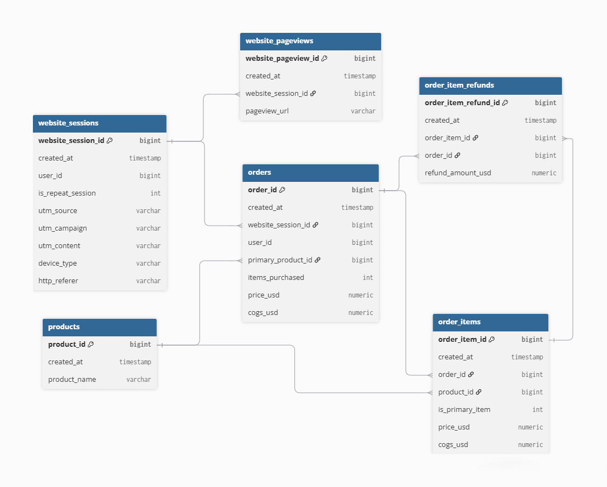

# Словарь данных

Набор данных содержит информацию о пользовательских сессиях на сайте,
просмотрах страниц, заказах, товарах и возвратах.

База состоит из шести связанных таблиц:

- `website_sessions` — пользовательские сессии;
- `website_pageviews` — просмотры страниц;
- `orders` — заказы;
- `order_items` — отдельные товары внутри заказов;
- `products` — справочник товаров;
- `order_item_refunds` — возвраты товаров.

## Схема данных

---

## `website_sessions`

Одна строка соответствует одной пользовательской сессии на сайте.

| Поле | Описание |
|---|---|
| `website_session_id` | Уникальный идентификатор сессии |
| `created_at` | Дата и время начала сессии |
| `user_id` | Идентификатор пользователя |
| `is_repeat_session` | Признак повторной сессии: 1 — пользователь уже посещал сайт ранее |
| `utm_source` | Источник трафика |
| `utm_campaign` | Название рекламной кампании |
| `utm_content` | Значение UTM-параметра, характеризующего рекламный материал или вариант объявления |
| `device_type` | Тип устройства: `mobile` или `desktop` |
| `http_referer` | URL-адрес страницы, с которой пользователь перешёл на сайт |

---

## `website_pageviews`

Одна строка соответствует одному просмотру страницы сайта.

| Поле | Описание |
|---|---|
| `website_pageview_id` | Уникальный идентификатор просмотра страницы |
| `created_at` | Дата и время просмотра страницы |
| `website_session_id` | Идентификатор сессии, в рамках которой произошёл просмотр |
| `pageview_url` | URL-путь просмотренной страницы |

Связь:

`website_pageviews.website_session_id` → `website_sessions.website_session_id`

Одна сессия может содержать несколько просмотров страниц.

---

## `orders`

Одна строка соответствует одному заказу.

| Поле | Описание |
|---|---|
| `order_id` | Уникальный идентификатор заказа |
| `created_at` | Дата и время оформления заказа |
| `website_session_id` | Идентификатор сессии, в рамках которой был оформлен заказ |
| `user_id` | Идентификатор пользователя |
| `primary_product_id` | Идентификатор основного товара в заказе |
| `items_purchased` | Количество приобретённых товаров |
| `price_usd` | Общая стоимость товаров в заказе, USD |
| `cogs_usd` | Себестоимость проданных товаров, USD |

Связи:

`orders.website_session_id` → `website_sessions.website_session_id`

`orders.primary_product_id` → `products.product_id`

---

## `order_items`

Одна строка соответствует одному товару внутри заказа.

| Поле | Описание |
|---|---|
| `order_item_id` | Уникальный идентификатор позиции заказа |
| `created_at` | Дата и время оформления заказа |
| `order_id` | Идентификатор заказа |
| `product_id` | Идентификатор товара |
| `is_primary_item` | Признак основного товара в заказе: 1 — основной товар |
| `price_usd` | Цена товара, USD |
| `cogs_usd` | Себестоимость товара, USD |

Связи:

`order_items.order_id` → `orders.order_id`

`order_items.product_id` → `products.product_id`

Один заказ может содержать несколько позиций.

---

## `products`

Справочник товаров.

Одна строка соответствует одному товару.

| Поле | Описание |
|---|---|
| `product_id` | Уникальный идентификатор товара |
| `created_at` | Дата и время запуска товара |
| `product_name` | Название товара |

Таблица используется для получения информации о товарах,
которые встречаются в заказах и отдельных позициях заказов.

---

## `order_item_refunds`

Одна строка соответствует одному возврату позиции заказа.

| Поле | Описание |
|---|---|
| `order_item_refund_id` | Уникальный идентификатор возврата |
| `created_at` | Дата и время оформления возврата |
| `order_item_id` | Идентификатор возвращённой позиции заказа |
| `order_id` | Идентификатор заказа, к которому относится возврат |
| `refund_amount_usd` | Сумма возврата, USD |

Связи:

`order_item_refunds.order_item_id` → `order_items.order_item_id`

`order_item_refunds.order_id` → `orders.order_id`

---